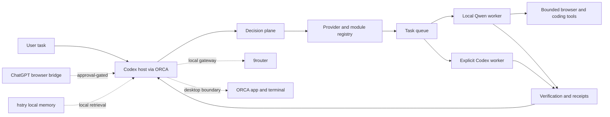

# Architecture

## Layers

1. **Interactive host:** Codex through ORCA receives the request and owns direct-versus-dispatch.
2. **Decision plane:** Quyet/local classifiers may advise route, module, and execution class; output never grants permission.
3. **Provider registry/adapters:** Codex/OpenAI and local Qwen have queue adapters; REA is read-only; Claude/Gemini are disabled placeholders.
4. **Task runtime:** `products/agent-runtime/` persists a queue, runs one bounded worker, records attempts, and returns normalized status.
5. **Modules:** browser, coding, desktop, knowledge, pedagogy, REA, and review integrations are bounded capabilities, not automatic dependencies.
6. **Host services:** ORCA, 9router, ChatGPT bridge, hstry, browser runtime, and model services remain outside this public repository.

9router is a local OpenAI-compatible gateway used by a dedicated Codex home in the observed host. It is not the brain. ORCA is the interactive terminal/app boundary; it does not replace the queue, registry, or verification contract.

Task lifecycle: `input -> frame constraints -> advisory decision -> registry eligibility -> explicit provider -> queue/adapter -> bounded tools -> verification -> normalized result -> host response`. Uncertain results retain the original task ID and are reconciled, not resubmitted.
